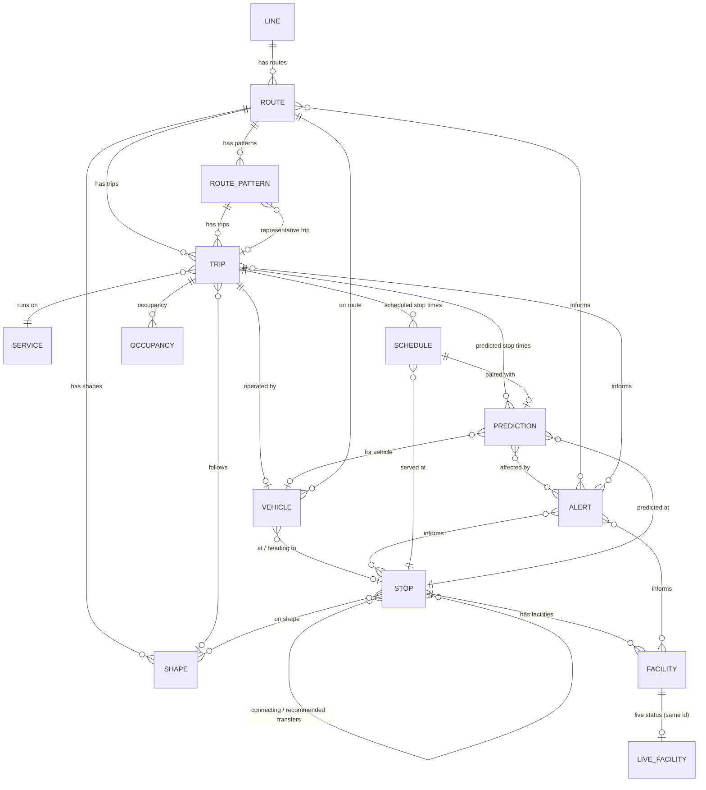

# MBTA V3 API: Data Schema & Relationships

> Resource Generated With Claude to Aid in Database Development
---
Base URL: `https://api-v3.mbta.com` · Format: [JSON:API](https://jsonapi.org/) · Model is based on GTFS / GTFS-realtime.

> **Source note.** The Swagger page is JavaScript-rendered, so this schema was assembled from the generated SDKs (Elixir, Go, Rust, TypeScript) and MBTA docs. SDKs are snapshots and can lag the live API. Items marked **(verify)** weren't confirmed. Section 8 has a script that dumps the *live* attributes and relationships for every resource so you can diff against this document.

---

## 1. Entity-relationship diagram



Not every line is a first-class relationship; see section 4 for which are real JSON:API relationships vs. derived or embedded.

---

## 2. Response envelope (applies to every endpoint)

```json
{
  "data": [ { "type": "stop", "id": "place-pktrm",
              "attributes": { "...": "..." },
              "relationships": {
                "parent_station": { "data": { "type": "stop", "id": "..." }, "links": { "self": "...", "related": "..." } },
                "child_stops":    { "data": [ { "type": "stop", "id": "..." } ] }
              },
              "links": { "self": "/stops/place-pktrm" } } ],
  "included": [ ],
  "links": { "self": "...", "first": "...", "prev": "...", "next": "...", "last": "..." },
  "jsonapi": { "version": "1.0" }
}
```

- `id` is always a **string**, unique within its `type`.
- `relationships.*.data` is `{type,id}` (to-one), an array of them (to-many), or `null`. By default only IDs appear; add `include=` to get full objects under `included`.
- Errors: `400` bad request, `403` bad/missing key, `404`, `406`, `429` rate limited (JSON:API `errors` array).

### Common query conventions

| Param | Notes |
|---|---|
| `filter[<name>]` | Varies per endpoint (section 6). Lists are comma-separated |
| `include` | Comma-separated relationship paths, valid values per endpoint (section 4) |
| `fields[<type>]` | Sparse fieldsets; also works for included types |
| `sort` | Attribute name, `-` prefix for descending |
| `page[limit]`, `page[offset]` | Pagination (offset is 0-based) |

---

## 3. Entities (attributes)

Type notes: `datetime` = ISO 8601 with offset; `date` = `YYYY-MM-DD`; `dir` = integer `0` or `1` (meaning is route-specific, see `Route.direction_names`). Nullable unless noted.

### 3.1 `line`: a grouping of routes (e.g., "Green Line")
| Attribute | Type |
|---|---|
| `long_name`, `short_name` | string |
| `color`, `text_color` | string (hex, no `#`) |
| `sort_order` | integer |

### 3.2 `route`
| Attribute | Type | Notes |
|---|---|---|
| `type` | integer | `0` light rail, `1` heavy rail (subway), `2` commuter rail, `3` bus, `4` ferry |
| `long_name`, `short_name`, `description` | string | |
| `color`, `text_color` | string | hex |
| `direction_names` | string[] | indexed by `direction_id` |
| `direction_destinations` | string[] | indexed by `direction_id` |
| `sort_order` | integer | |
| `fare_class` | string | appears in sortable fields **(verify)** |

### 3.3 `route_pattern`: a canonical way a route is served
| Attribute | Type | Notes |
|---|---|---|
| `name` | string | user-facing, e.g. "Ashmont - Alewife" |
| `direction_id` | dir | |
| `typicality` | integer | `0` undefined, `1` typical, `2` deviation, `3` highly atypical, `4` diversion (detour/shuttle/snow route) |
| `time_desc` | string | when the pattern operates |
| `sort_order` | integer | presentation order |

### 3.4 `trip`: one journey of a vehicle through a set of stops
| Attribute | Type | Notes |
|---|---|---|
| `name` | string | e.g., commuter rail train number |
| `headsign` | string | destination sign text |
| `direction_id` | dir | |
| `block_id` | string | groups sequential trips by the same vehicle |
| `wheelchair_accessible` | integer | `0` no info, `1` accessible, `2` not |
| `bikes_allowed` | integer | `0` no info, `1` allowed, `2` not allowed |

### 3.5 `shape`
| Attribute | Type | Notes |
|---|---|---|
| `polyline` | string | [Encoded Polyline](https://developers.google.com/maps/documentation/utilities/polylinealgorithm) |
| `name` | string | |
| `direction_id` | dir | |
| `priority` | integer | higher = more important for display; negative = not worth showing |

(An older Elixir SDK lists only `polyline`; the TypeScript SDK lists all four **(verify)**.)

### 3.6 `service`: a set of dates on which trips run (GTFS calendar)
| Attribute | Type |
|---|---|
| `description`, `schedule_name` | string |
| `schedule_type` | string |
| `schedule_typicality` | integer: `0` undefined, `1` typical, `2` supplemental/extra, `3` reduced/holiday, `4` planned major change, `5` unplanned major reduction |
| `start_date`, `end_date` | date |
| `valid_days` | integer[] (weekday numbers, 1 = Monday … 7 = Sunday) |
| `added_dates`, `removed_dates` | date[] |
| `added_dates_notes`, `removed_dates_notes` | (string \| null)[], parallel to the date arrays |

### 3.7 `stop`: stations, platforms, entrances, bus stops
| Attribute | Type | Notes |
|---|---|---|
| `name` | string | |
| `latitude`, `longitude` | float | WGS-84 |
| `address`, `municipality` | string | |
| `on_street`, `at_street` | string | cross-street descriptors |
| `description` | string | |
| `platform_code`, `platform_name` | string | |
| `location_type` | integer | `0` stop/platform, `1` station, `2` entrance/exit, `3` generic node, `4` boarding area |
| `wheelchair_boarding` | integer | `0` no info, `1` accessible, `2` inaccessible (parent-station inheritance handled by the API) |
| `vehicle_type` | integer | same codes as `route.type` |

### 3.8 `schedule`: planned stop time (GTFS `stop_times`)
| Attribute | Type | Notes |
|---|---|---|
| `arrival_time`, `departure_time` | datetime | |
| `direction_id` | dir | |
| `stop_sequence` | integer | increasing along a trip, not necessarily consecutive |
| `pickup_type`, `drop_off_type` | integer | `0` regular, `1` none, `2` must phone agency, `3` must coordinate with driver |
| `timepoint` | boolean | `true` = exact, `false` = estimate |
| `stop_headsign` | string | **(verify)** |

### 3.9 `prediction`: real-time predicted stop time
| Attribute | Type | Notes |
|---|---|---|
| `arrival_time`, `departure_time` | datetime | |
| `direction_id` | dir | |
| `stop_sequence` | integer | |
| `schedule_relationship` | enum | `ADDED`, `CANCELLED`, `NO_DATA`, `SKIPPED`, `UNSCHEDULED`, or null (scheduled) |
| `status` | string | free-text, e.g. "Now boarding" |

Newer SDKs may add uncertainty and last-trip style fields **(verify)**.

### 3.10 `vehicle`: current state of a vehicle on a trip
| Attribute | Type | Notes |
|---|---|---|
| `label` | string | |
| `latitude`, `longitude` | float | |
| `bearing` | integer | degrees |
| `speed` | float | |
| `direction_id` | dir | |
| `current_status` | enum | `INCOMING_AT`, `STOPPED_AT`, `IN_TRANSIT_TO` |
| `current_stop_sequence` | integer | |
| `occupancy_status` | enum | GTFS-rt values (`EMPTY`, `MANY_SEATS_AVAILABLE`, `FEW_SEATS_AVAILABLE`, `STANDING_ROOM_ONLY`, `CRUSHED_STANDING_ROOM_ONLY`, `FULL`, `NOT_ACCEPTING_PASSENGERS`) |
| `carriages` | object[] | per-car info (label, occupancy…) **(verify fields)** |
| `updated_at` | datetime | |

### 3.11 `alert`
| Attribute | Type | Notes |
|---|---|---|
| `header`, `short_header`, `description`, `banner` | string | `banner` set = show prominently |
| `service_effect`, `timeframe` | string | |
| `effect` | enum | see Appendix |
| `cause` | enum | see Appendix |
| `severity` | integer | 0 (least) to 10 (most) |
| `lifecycle` | enum | `NEW`, `ONGOING`, `ONGOING_UPCOMING`, `UPCOMING` |
| `active_period` | `{start, end}[]` | `end` nullable |
| `informed_entity` | object[] | `{trip, stop, route, route_type, facility, direction_id, activities[]}` |
| `url` | string | |
| `image` | string | URL to descriptive image **(verify)** |
| `created_at`, `updated_at` | datetime | |

`informed_entity` is the **intersection** of its fields, not the union: if `stop` and `route` are both set, the alert does *not* affect the whole route. `activities` values: `BOARD`, `BRINGING_BIKE`, `EXIT`, `PARK_CAR`, `RIDE`, `STORE_BIKE`, `USING_ESCALATOR`, `USING_WHEELCHAIR`.

### 3.12 `facility`: elevators, escalators, parking, bike storage, etc.
| Attribute | Type |
|---|---|
| `name`, `short_name` | string |
| `type` | enum (see Appendix) |
| `latitude`, `longitude` | float |
| `properties` | `{name, value}[]` |

### 3.13 `live_facility`: current operational status of a facility
Shares its `id` with the matching `facility`. Attributes: `properties` (name/value pairs) and `updated_at` **(verify)**.

### 3.14 `occupancy`: expected/predicted occupancy for a trip
Exists as a resource type and as `trip` → `occupancies` relationship. Attribute list not confirmed **(verify via section 8)**.

### 3.15 Possibly present: `agency` **(verify)**
Some documentation lists agency data; confirm with `GET /agencies` and the script in section 8.

---

## 4. Relationships

"Include" = valid value for `?include=` on that endpoint.

| From → To | Cardinality | JSON:API relationship name | Include on |
|---|---|---|---|
| `line` → `route` | 1 : many | `routes` | `/lines` |
| `route` → `line` | many : 1 | `line` | `/routes` |
| `route` → `route_pattern` | 1 : many | `route_patterns` | `/routes` |
| `route` → `stop` | many : many (derived) | `stop` | `/routes` (with `filter[stop]`) |
| `route_pattern` → `route` | many : 1 | `route` | `/route_patterns` |
| `route_pattern` → `trip` | many : 1 | `representative_trip` | `/route_patterns` |
| `trip` → `route` | many : 1 | `route` | `/trips` |
| `trip` → `route_pattern` | many : 1 | `route_pattern` | `/trips` |
| `trip` → `service` | many : 1 | `service` | `/trips` |
| `trip` → `shape` | many : 0..1 | `shape` | `/trips` |
| `trip` → `vehicle` | 1 : 0..1 | `vehicle` | `/trips` |
| `trip` → `prediction` | 1 : many | `predictions` | `/trips` |
| `trip` → `stop` | many : many | `stops` | `/trips` |
| `trip` → `occupancy` | 1 : many | `occupancies` | `/trips` |
| `shape` → `route` | many : 1 | `route` | `/shapes` |
| `shape` → `stop` | many : many | `stops` | `/shapes` |
| `stop` → `stop` (parent) | many : 0..1 | `parent_station` | `/stops` |
| `stop` → `stop` (children) | 1 : many | `child_stops` | `/stops` |
| `stop` → `stop` (connections) | many : many | `connecting_stops` | `/stops` |
| `stop` → `stop` (transfers) | many : many | `recommended_transfers` | `/stops` **(verify current)** |
| `stop` → `facility` | 1 : many | `facilities` | `/stops` |
| `stop` → `route` | many : 1 | `route` | `/stops` (only when `filter[route]` has exactly one route) |
| `facility` → `stop` | many : 1 | `stop` | `/facilities` |
| `schedule` → `trip` / `route` / `stop` | many : 1 each | `trip`, `route`, `stop` | `/schedules` |
| `schedule` → `prediction` | 1 : 0..1 | `prediction` | `/schedules` |
| `prediction` → `trip` / `route` / `stop` | many : 1 each | `trip`, `route`, `stop` | `/predictions` |
| `prediction` → `schedule` | 0..1 : 1 | `schedule` | `/predictions` |
| `prediction` → `vehicle` | many : 0..1 | `vehicle` | `/predictions` |
| `prediction` → `alert` | many : many | `alerts` | `/predictions` |
| `vehicle` → `route` / `trip` / `stop` | many : 1 each | `route`, `trip`, `stop` | `/vehicles` |
| `alert` → `stop` / `route` / `trip` / `facility` | many : many | `stops`, `routes`, `trips`, `facilities` | `/alerts` |

### Relationship kinds

- **True relationships (foreign keys):** everything in the `relationships` object of a resource.
- **Embedded references:** `alert.informed_entity[]` holds IDs as plain attributes (`route`, `stop`, `trip`, `facility`). Treat as soft references.
- **Derived:** route↔stop is not stored directly; it comes from trips/route patterns and is exposed through filters (`/stops?filter[route]=Red`, `/routes?filter[stop]=...`).
- **Identity link:** `facility` and `live_facility` share an `id`.
- **Service ↔ route:** `/services` accepts `filter[route]`, but the link goes through `trip.service` and `trip.route`.

---

## 5. Entity hierarchy (how to think about it)

```
Line
 └─ Route
     ├─ RoutePattern ──(representative)──► Trip
     ├─ Shape ◄── Trip.shape
     └─ Trip ── Service (calendar)
         ├─ Schedule  (planned, per stop)   ◄─ Stop
         ├─ Prediction (real-time, per stop) ◄─ Stop, ► Alert, ► Vehicle
         ├─ Vehicle   (current position)     ► Stop, Route
         └─ Occupancy

Stop (station) ─ child Stops (platforms/entrances) ─ Facility ─ LiveFacility
Alert ─ (informed_entity) ─► Route / Stop / Trip / Facility
```

---

## 6. Endpoints and key filters

| Endpoint | Resource | Required filter? | Notable filters |
|---|---|---|---|
| `/lines`, `/lines/{id}` | line | no | `id` |
| `/routes`, `/routes/{id}` | route | no | `id`, `type`, `stop`, `direction_id`, `date` |
| `/route_patterns`, `/route_patterns/{id}` | route_pattern | no | `id`, `route`, `direction_id`, `stop` |
| `/trips`, `/trips/{id}` | trip | no | `id`, `route`, `route_pattern`, `direction_id`, `date`, `name` |
| `/shapes`, `/shapes/{id}` | shape | **`route`** | `route`, `direction_id` |
| `/services`, `/services/{id}` | service | no | `id`, `route` |
| `/stops`, `/stops/{id}` | stop | no | `id`, `route`, `route_type`, `direction_id`, `location_type`, `latitude`+`longitude`+`radius` |
| `/schedules` | schedule | **one of `route`, `stop`, `trip`** | `date`, `direction_id`, `min_time`, `max_time`, `stop_sequence` |
| `/predictions` | prediction | **at least one filter** | `route`, `stop`, `trip`, `route_type`, `direction_id`, `latitude`+`longitude`+`radius` |
| `/vehicles`, `/vehicles/{id}` | vehicle | no | `id`, `trip`, `route`, `label`, `route_type`, `direction_id` |
| `/alerts`, `/alerts/{id}` | alert | no | `route`, `stop`, `trip`, `facility`, `activity`, `route_type`, `direction_id`, `banner`, `datetime`, `lifecycle`, `severity`, `id` |
| `/facilities`, `/facilities/{id}` | facility | no | `stop`, `type` |
| `/live_facilities`, `/live_facilities/{id}` | live_facility | no | `id` |

Filters on `/shapes`, `/route_patterns` and `/services` come from SDK snapshots; Swagger is authoritative.

Geo filters: `filter[radius]` is in **degrees** on a flat plane (default ~0.01, roughly half a mile in Boston; 0.02 ≈ 1 mile).

---

## 7. Appendix: enums

**Alert `effect`:** ACCESS_ISSUE, ADDITIONAL_SERVICE, AMBER_ALERT, BIKE_ISSUE, CANCELLATION, DELAY, DETOUR, DOCK_CLOSURE, DOCK_ISSUE, ELEVATOR_CLOSURE, ESCALATOR_CLOSURE, EXTRA_SERVICE, FACILITY_ISSUE, MODIFIED_SERVICE, NO_SERVICE, OTHER_EFFECT, PARKING_CLOSURE, PARKING_ISSUE, POLICY_CHANGE, SCHEDULE_CHANGE, SERVICE_CHANGE, SHUTTLE, SNOW_ROUTE, STATION_CLOSURE, STATION_ISSUE, STOP_CLOSURE, STOP_MOVE, STOP_MOVED, SUMMARY, SUSPENSION, TRACK_CHANGE, UNKNOWN_EFFECT

**Alert `cause`:** ACCIDENT, AMTRAK, AN_EARLIER_MECHANICAL_PROBLEM, AN_EARLIER_SIGNAL_PROBLEM, AUTOS_IMPEDING_SERVICE, COAST_GUARD_RESTRICTION, CONGESTION, CONSTRUCTION, CROSSING_MALFUNCTION, DEMONSTRATION, DISABLED_BUS, DISABLED_TRAIN, DRAWBRIDGE_BEING_RAISED, ELECTRICAL_WORK, FIRE, FOG, FREIGHT_TRAIN_INTERFERENCE, HAZMAT_CONDITION, HEAVY_RIDERSHIP, HIGH_WINDS, HOLIDAY, HURRICANE, ICE_IN_HARBOR, MAINTENANCE, MECHANICAL_PROBLEM, MEDICAL_EMERGENCY, PARADE, POLICE_ACTION, POWER_PROBLEM, SEVERE_WEATHER, SIGNAL_PROBLEM, SLIPPERY_RAIL, SNOW, SPECIAL_EVENT, SPEED_RESTRICTION, SWITCH_PROBLEM, TIE_REPLACEMENT, TRACK_PROBLEM, TRACK_WORK, TRAFFIC, UNKNOWN_CAUSE, UNRULY_PASSENGER, WEATHER

**Facility `type`:** BIKE_STORAGE, BRIDGE_PLATE, ELECTRIC_CAR_CHARGERS, ELEVATED_SUBPLATFORM, ELEVATOR, ESCALATOR, FARE_MEDIA_ASSISTANCE_FACILITY, FARE_MEDIA_ASSISTANT, FARE_VENDING_MACHINE, FARE_VENDING_RETAILER, FULLY_ELEVATED_PLATFORM, OTHER, PARKING_AREA, PICK_DROP, PORTABLE_BOARDING_LIFT, RAMP, TAXI_STAND, TICKET_WINDOW

Enum lists come from an SDK snapshot; the API can add values, so treat unknown values defensively in code.

---

## 8. Verify against the live API

Dumps the real attribute and relationship names for each resource (about 13 requests, far under the rate limit). Uses the key from `.env` (`MBTA_API_KEY`).

```python
import json, os, requests
from dotenv import load_dotenv

load_dotenv()
BASE = "https://api-v3.mbta.com"
HEADERS = {"x-api-key": os.environ["MBTA_API_KEY"]}

# endpoints, with any filter required to return data
ENDPOINTS = {
    "lines": {},
    "routes": {},
    "route_patterns": {},
    "trips": {"filter[route]": "Red"},
    "shapes": {"filter[route]": "Red"},
    "services": {},
    "stops": {},
    "schedules": {"filter[route]": "Red"},
    "predictions": {"filter[route]": "Red"},
    "vehicles": {},
    "alerts": {},
    "facilities": {},
    "live_facilities": {},
    "occupancies": {},   # may 404 or be empty; that's informative too
    "agencies": {},      # same
}

schema = {}
for name, params in ENDPOINTS.items():
    r = requests.get(f"{BASE}/{name}", headers=HEADERS,
                     params={**params, "page[limit]": 1}, timeout=10)
    if r.status_code != 200 or not r.json().get("data"):
        schema[name] = {"status": r.status_code, "note": "no data or not available"}
        continue
    item = r.json()["data"][0]
    schema[name] = {
        "type": item["type"],
        "attributes": {k: type(v).__name__ for k, v in item["attributes"].items()},
        "relationships": list(item.get("relationships", {}).keys()),
    }

print(json.dumps(schema, indent=2))
```

Caveats: `None` values show as `NoneType`, so a nullable field may look untyped; sample a few records for edge cases. Fields absent from the one sampled record won't appear.

---

## 9. Quick checklist for building on this schema

- [ ] Treat all IDs as strings; stop IDs include forms like `place-pktrm` (station) and numeric bus stops
- [ ] Use `include=` to avoid N+1 requests (each request counts against the 1,000/min limit)
- [ ] Always supply a filter for `/predictions`, `/schedules`, `/shapes`
- [ ] Resolve `stop.parent_station` for location/accessibility context
- [ ] Parse `alert.informed_entity` as an intersection per entry
- [ ] Handle unknown enum values and nullable fields
- [ ] Re-run the section 8 script periodically to catch API changes